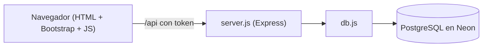

## Vista general


## Backend
| Archivo | Función |
|---|---|
| `server.js` | TallerGest – servidor (Express + Postgres/Neon). Sirve el frontend de /public y la API /api |
| `db.js` | TallerGest – capa de base de datos (Postgres / Neon). Una tabla por módulo. |
| `loadenv.js` | Lee el archivo .env (si existe) y carga sus variables. No pisa las que ya estén definidas en el sistema. |
| `scripts/generar-docs.js` | Genera esta documentación |

## Frontend
Cada página HTML carga `js/cargador.js`, que incluye el núcleo (`js/core`), luego **el archivo de esa pantalla** (`js/pantallas/<pagina>.js`) y por último el arranque. Para modificar una pantalla, busca su archivo con el mismo nombre que la página.

### Núcleo (`js/core`)
| Archivo | Función |
|---|---|
| `js/core/arranque.js` | NÚCLEO · arranque — se ejecuta al final: valida la sesión, carga los datos y dibuja la pantalla |
| `js/core/ayuda-datos.js` | NÚCLEO · contenido del Centro de ayuda (distinto para cada rol). |
| `js/core/base.js` | NÚCLEO · base — utilidades y constantes compartidas por todas las pantallas |
| `js/core/bitacora.js` | NÚCLEO · bitácora — arma el detalle que se guarda en la auditoría (qué se creó, qué cambió y por cuáles datos) |
| `js/core/clientevehiculo.js` | NÚCLEO · cliente y vehículo — elegir el cliente escribiendo su nombre y luego uno de SUS vehículos. |
| `js/core/cotizador.js` | NÚCLEO · cotizador — elegir servicios y repuestos con cálculo automático (ITBIS 18%). |
| `js/core/crud.js` | NÚCLEO · crud — motor de las pantallas de registros: tabla, buscador, paginación, formulario y detalle. |
| `js/core/datos.js` | NÚCLEO · datos — comunicación con el servidor y copia local de los datos |
| `js/core/flujo.js` | NÚCLEO · flujo — lo que pasa automáticamente entre áreas: estados de la orden, avisos, stock y notas compartidas |
| `js/core/fotos.js` | NÚCLEO · fotos — fotos de la recepción del vehículo (evidencia de cómo lo entregan). |
| `js/core/impresion.js` | NÚCLEO · impresión — logo, hojas con membrete (facturas, cotizaciones, reportes) y exportación a Excel |
| `js/core/modulos.js` | NÚCLEO · módulos — menú, permisos por rol y nombres que se muestran de cada registro. |
| `js/core/shell.js` | NÚCLEO · estructura — menú lateral, barra superior, campana de avisos y salida |
| `js/core/turno.js` | NÚCLEO · turno — el turno de cada usuario empieza en su último cierre o a las 00:00 del día (lo que sea más reciente). |
| `js/core/ui.js` | NÚCLEO · interfaz — componentes reutilizables: lista con buscador (combo) y paginación |

### Pantallas (`js/pantallas`)
| Archivo | Función |
|---|---|
| `js/pantallas/aprobacion.js` | PANTALLA · Aprobación del cliente (se identifica la cotización por cliente, vehículo, orden y monto) |
| `js/pantallas/auditoria.js` | PANTALLA · Auditoría (solo lectura, solo administrador): quién hizo qué, sobre qué registro y qué datos cambiaron |
| `js/pantallas/ayuda.js` | PANTALLA · Centro de ayuda (el contenido está en js/core/ayuda-datos.js y cambia según el rol) |
| `js/pantallas/clientes.js` | PANTALLA · Registro de clientes |
| `js/pantallas/configuracion.js` | PANTALLA · Configuración del taller (nombre, RNC, logo y pie de los documentos impresos) |
| `js/pantallas/cotizaciones.js` | PANTALLA · Cotizaciones (servicios y repuestos con ITBIS; muestra lo que pidió el mecánico y deja una nota para facturación) |
| `js/pantallas/dashboard.js` | PANTALLA · Inicio (resumen del día: mi turno, alertas, órdenes en curso y órdenes del turno por estado) |
| `js/pantallas/diagnostico.js` | PANTALLA · Diagnóstico (el mecánico también indica qué repuestos y servicios necesita; quien cotiza lo ve) |
| `js/pantallas/ejecucion.js` | PANTALLA · Ejecución del trabajo (el mecánico solo ve sus órdenes y solo las etapas que le faltan) |
| `js/pantallas/facturacion.js` | PANTALLA · Facturación (carga los ítems de la cotización aprobada y muestra las notas de la orden) |
| `js/pantallas/historial.js` | PANTALLA · Historial de mantenimiento (se llena solo al finalizar un trabajo; también se puede registrar a mano) |
| `js/pantallas/login.js` | PANTALLA · Inicio de sesión (un usuario solo puede tener una sesión activa a la vez) |
| `js/pantallas/mecanicos.js` | PANTALLA · Asignación de mecánicos (solo órdenes «Recibida»; el mecánico recibe un aviso) |
| `js/pantallas/ordenes.js` | PANTALLA · Órdenes de trabajo (el mecánico solo ve las suyas y solo puede mirarlas, con todas sus notas) |
| `js/pantallas/pagos.js` | PANTALLA · Pagos (formulario según el método; pagos parciales; nunca más que el saldo) |
| `js/pantallas/recepcion.js` | PANTALLA · Recepción del vehículo (cliente → vehículo, observaciones y fotos de evidencia; crea la orden de trabajo solo) |
| `js/pantallas/reportes.js` | PANTALLA · Reportes y cierre de caja (el cierre incluye solo lo que registró el usuario desde su último cierre o desde las 00:00) |
| `js/pantallas/repuestos.js` | PANTALLA · Gestión de repuestos (el código se genera solo; no se permiten repuestos repetidos) |
| `js/pantallas/servicios.js` | PANTALLA · Gestión de servicios |
| `js/pantallas/usuarios.js` | PANTALLA · Usuarios y roles (solo administrador) |
| `js/pantallas/vehiculos.js` | PANTALLA · Registro de vehículos (cada vehículo pertenece a un cliente; un cliente puede tener varios) |

## Cómo se define una pantalla
Las pantallas de registros se configuran con `pantalla('<modulo>', { ... })` y el motor de `core/crud.js` aporta la tabla, el buscador, la paginación, el formulario y el detalle. Opciones disponibles:

```text
Cada pantalla (js/pantallas/<modulo>.js) lo configura con pantalla('<modulo>',{...}). Opciones disponibles:
     f            campos [clave, etiqueta, tipo, opciones, filtroDeOpciones]
     extra        columnas extra de la tabla [[título, r=>html]]
     acciones     r=>html con botones extra de cada fila (y clic(boton,registro) para atenderlos)
     celda        (campo,r)=>html para personalizar cómo se ve una celda
     campo        (campo,valor,registroActual)=>html para personalizar un campo del formulario
     cuerpo       r=>html que reemplaza todo el formulario        pie  r=>html que se agrega al final del formulario
     alAbrir      r=>{} se ejecuta al abrir el formulario (aquí se enlazan eventos con formOn)
     preparar     (datos,anterior,lista)=>error|undefined   completa o valida los datos antes de guardar
     validar      (listaNueva,registro,anterior)=>error|undefined
     despues      (registro,anterior,promesaDeGuardado)=>mensaje|undefined   efectos entre áreas, avisos
     antesEliminar (registro,resto)=>error|undefined
     detalle      r=>html extra para la ventana «Ver detalle»
     dup          [campo, x=>mensaje] evita repetidos (ignora mayúsculas, tildes y espacios)
     filtros      ()=>html de filtros extra          filtro  r=>boolean
     turno        true: permite filtrar «solo mis registros de este turno»
     soloLectura  roles que solo pueden mirar         clienteVehiculo  true: elegir cliente y luego su vehículo
     grande       true: formulario ancho              ordenar  filas=>filas
```
