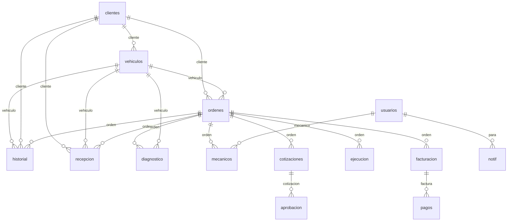

Cada módulo tiene su propia tabla. Todas incluyen `id` (texto, se genera solo si se inserta a mano), `seq` (orden de inserción) y `extra` (JSON con datos adicionales). Las tablas se crean y se actualizan solas al iniciar el servidor.

## usuarios
| Columna | Tipo | Relación |
|---|---|---|
| `usuario` | texto |  |
| `nombre` | texto |  |
| `rol` | texto |  |
| `estado` | texto |  |
| `hash` | texto |  |

## clientes
| Columna | Tipo | Relación |
|---|---|---|
| `nombre` | texto |  |
| `telefono` | texto |  |
| `correo` | texto |  |
| `direccion` | texto |  |
| `por` | texto |  |
| `por_nombre` | texto |  |
| `creado` | fecha y hora |  |

## vehiculos
| Columna | Tipo | Relación |
|---|---|---|
| `placa` | texto |  |
| `marca` | texto |  |
| `modelo` | texto |  |
| `anio` | entero |  |
| `cliente` | texto | → `clientes` |
| `por` | texto |  |
| `por_nombre` | texto |  |
| `creado` | fecha y hora |  |

## ordenes
| Columna | Tipo | Relación |
|---|---|---|
| `codigo` | texto |  |
| `cliente` | texto | → `clientes` |
| `vehiculo` | texto | → `vehiculos` |
| `estado` | texto |  |
| `fecha` | fecha |  |
| `motivo` | texto |  |
| `actualizado` | fecha y hora |  |
| `por` | texto |  |
| `por_nombre` | texto |  |
| `creado` | fecha y hora |  |

## historial
| Columna | Tipo | Relación |
|---|---|---|
| `vehiculo` | texto | → `vehiculos` |
| `cliente` | texto | → `clientes` |
| `orden` | texto | → `ordenes` |
| `fecha` | fecha |  |
| `servicio` | texto |  |
| `km` | entero |  |
| `tecnico` | texto |  |
| `por` | texto |  |
| `por_nombre` | texto |  |
| `creado` | fecha y hora |  |

## recepcion
| Columna | Tipo | Relación |
|---|---|---|
| `cliente` | texto | → `clientes` |
| `vehiculo` | texto | → `vehiculos` |
| `orden` | texto | → `ordenes` |
| `fecha` | fecha |  |
| `km` | entero |  |
| `obs` | texto |  |
| `por` | texto |  |
| `por_nombre` | texto |  |
| `creado` | fecha y hora |  |

## diagnostico
| Columna | Tipo | Relación |
|---|---|---|
| `orden` | texto | → `ordenes` |
| `vehiculo` | texto | → `vehiculos` |
| `resultado` | texto |  |
| `hallazgos` | texto |  |
| `necesidades` | JSON |  |
| `otras` | texto |  |
| `por` | texto |  |
| `por_nombre` | texto |  |
| `creado` | fecha y hora |  |

## mecanicos
| Columna | Tipo | Relación |
|---|---|---|
| `orden` | texto | → `ordenes` |
| `mecanico` | texto | → `usuarios` |
| `fecha` | fecha |  |
| `por` | texto |  |
| `por_nombre` | texto |  |
| `creado` | fecha y hora |  |

## servicios
| Columna | Tipo | Relación |
|---|---|---|
| `descripcion` | texto |  |
| `categoria` | texto |  |
| `precio` | decimal |  |
| `por` | texto |  |
| `por_nombre` | texto |  |
| `creado` | fecha y hora |  |

## repuestos
| Columna | Tipo | Relación |
|---|---|---|
| `codigo` | texto |  |
| `descripcion` | texto |  |
| `stock` | entero |  |
| `precio` | decimal |  |
| `por` | texto |  |
| `por_nombre` | texto |  |
| `creado` | fecha y hora |  |

## cotizaciones
| Columna | Tipo | Relación |
|---|---|---|
| `orden` | texto | → `ordenes` |
| `descripcion` | texto |  |
| `items` | JSON |  |
| `subtotal` | decimal |  |
| `itbis` | decimal |  |
| `total` | decimal |  |
| `estado` | texto |  |
| `stock_desc` | sí/no |  |
| `nota` | texto |  |
| `por` | texto |  |
| `por_nombre` | texto |  |
| `creado` | fecha y hora |  |

## aprobacion
| Columna | Tipo | Relación |
|---|---|---|
| `cotizacion` | texto | → `cotizaciones` |
| `decision` | texto |  |
| `fecha` | fecha |  |
| `comentario` | texto |  |
| `por` | texto |  |
| `por_nombre` | texto |  |
| `creado` | fecha y hora |  |

## ejecucion
| Columna | Tipo | Relación |
|---|---|---|
| `orden` | texto | → `ordenes` |
| `etapa` | texto |  |
| `notas` | texto |  |
| `por` | texto |  |
| `por_nombre` | texto |  |
| `creado` | fecha y hora |  |

## facturacion
| Columna | Tipo | Relación |
|---|---|---|
| `numero` | texto |  |
| `orden` | texto | → `ordenes` |
| `descripcion` | texto |  |
| `items` | JSON |  |
| `subtotal` | decimal |  |
| `itbis` | decimal |  |
| `total` | decimal |  |
| `fecha` | fecha |  |
| `por` | texto |  |
| `por_nombre` | texto |  |
| `creado` | fecha y hora |  |

## pagos
| Columna | Tipo | Relación |
|---|---|---|
| `factura` | texto | → `facturacion` |
| `monto` | decimal |  |
| `metodo` | texto |  |
| `fecha` | fecha |  |
| `detalle` | texto |  |
| `recibido` | decimal |  |
| `devuelta` | decimal |  |
| `marca` | texto |  |
| `ultimos4` | texto |  |
| `autorizacion` | texto |  |
| `cuotas` | texto |  |
| `banco` | texto |  |
| `referencia` | texto |  |
| `ncheque` | texto |  |
| `notas` | texto |  |
| `por` | texto |  |
| `por_nombre` | texto |  |
| `creado` | fecha y hora |  |

## auditoria
| Columna | Tipo | Relación |
|---|---|---|
| `fecha` | texto |  |
| `usuario` | texto |  |
| `nombre` | texto |  |
| `accion` | texto |  |
| `modulo` | texto |  |
| `registro` | texto |  |
| `detalle` | texto |  |
| `creado` | fecha y hora |  |

## notif
| Columna | Tipo | Relación |
|---|---|---|
| `para` | texto | → `usuarios` (se borra en cascada) |
| `texto` | texto |  |
| `fecha` | texto |  |
| `leida` | sí/no |  |

## cierres
| Columna | Tipo | Relación |
|---|---|---|
| `por` | texto |  |
| `nombre` | texto |  |
| `rol` | texto |  |
| `desde` | fecha y hora |  |
| `hasta` | fecha y hora |  |
| `pagos` | entero |  |
| `total` | decimal |  |
| `metodos` | JSON |  |
| `resumen` | texto |  |

## cfg
| Columna | Tipo | Relación |
|---|---|---|
| `nombre` | texto |  |
| `rnc` | texto |  |
| `telefono` | texto |  |
| `correo` | texto |  |
| `direccion` | texto |  |
| `pie` | texto |  |
| `logo` | texto |  |

## recepcion_fotos
Fotos de la recepción: `recepcion` (→ `recepcion`, en cascada), `nombre`, `tipo`, `datos` (imagen), `por`, `creado`.

## sesiones
Una fila por sesión activa: `usuario` (→ `usuarios`, en cascada), `creado`, `ultima` (último movimiento), `ip`, `agente`. Garantiza una sola sesión por usuario.
