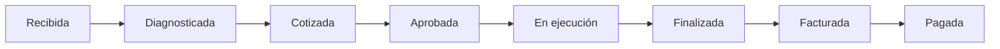

Una orden de trabajo se crea sola al recibir el vehículo y avanza únicamente hacia adelante.

## Pasos y responsables
| # | Paso | Módulo | Responsable |
|---|---|---|---|
| 1 | Recepción | Recepción del vehículo | Recepcionista |
| 2 | Asignar mecánico | Asignación de mecánicos | Recepcionista |
| 3 | Diagnóstico | Diagnóstico | Mecánico |
| 4 | Cotización | Cotizaciones | Facturador, Recepcionista |
| 5 | Aprobación del cliente | Aprobación del cliente | Recepcionista |
| 6 | Ejecución | Ejecución del trabajo | Mecánico |
| 7 | Facturación | Facturación | Facturador |
| 8 | Pago | Pagos | Facturador |

## Estados
| Estado | Significado |
|---|---|
| Recibida | El vehículo ingresó y se abrió la orden. |
| Diagnosticada | El mecánico terminó el diagnóstico. |
| Cotizada | Hay una cotización esperando la respuesta del cliente. |
| Aprobada | El cliente aprobó: ya se puede trabajar y facturar. |
| En ejecución | El mecánico está realizando el trabajo. |
| Finalizada | El trabajo terminó y el vehículo está listo para entregar. |
| Facturada | Se emitió la factura; falta el cobro. |
| Pagada | La factura fue pagada por completo. |

